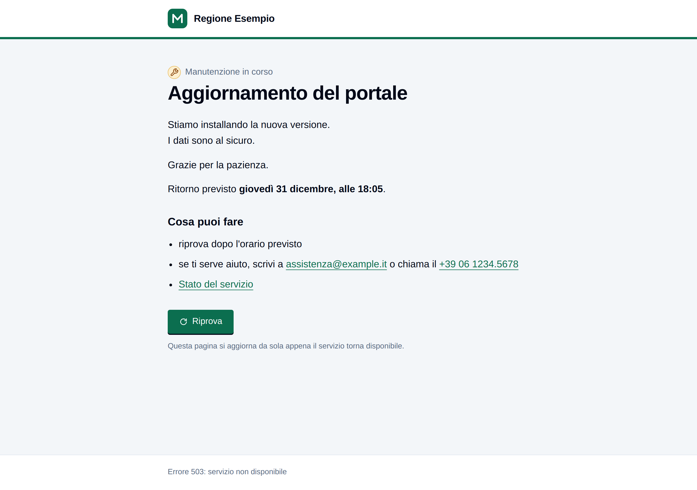
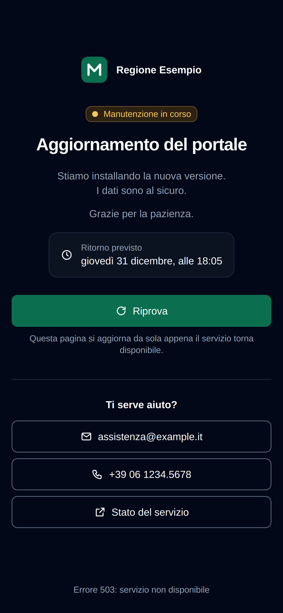

# gateway

Railway non ha una modalità manutenzione. Questo è il nostro modo di averla, uguale per ogni progetto
(dal template o no, Laravel o qualunque altro linguaggio, un servizio solo o tanti): un servizio in più,
il **gateway**, che possiede i domini pubblici e

- con `MAINTENANCE=off` passa ogni dominio al servizio giusto sulla rete privata di Railway;
- con `MAINTENANCE=on` non passa niente e risponde **503** con la pagina di manutenzione (JSON per le API);
- in ogni caso mostra da solo la stessa pagina quando il servizio dietro è spento, non risponde entro
  5 secondi, o risponde 502, 503 o 504.

È un'immagine pronta, `ghcr.io/mbs-francesco-la-ruffa/gateway`: Caddy a una versione fissa più uno script che a ogni
avvio scrive la configurazione e la pagina partendo dalle variabili. Accendere o spegnere la
manutenzione, o cambiarne il testo, vuol dire cambiare una variabile: Railway riavvia l'immagine, **senza
build e senza coda**, in pochi secondi. Il DNS del cliente non cambia mai.

```
browser ──https──▶ edge di Railway ──http──▶ gateway ──http, rete privata──▶ frontend:8080
                   (TLS, X-Forwarded-*)       dominio → servizio            └─▶ backend:8080
                                              MAINTENANCE=on: pagina 503, non passa niente
```





## Cosa c'è qui

| File | Cos'è |
|---|---|
| `Dockerfile` | L'immagine: `caddy:<versione>-alpine` più i due file sotto. Si avvia da sola, senza start command. |
| `gateway.sh` | Lo script che parte a ogni avvio: controlla le variabili, scrive la pagina, il JSON e la configurazione di Caddy, poi avvia Caddy. |
| `page.html` | Il modello della pagina di manutenzione. Lo script lo riempie con le variabili, tutte facoltative. |
| `bin/maintenance.mjs` | Il comando per accendere, spegnere e controllare la manutenzione su qualunque progetto. |
| `examples/docker-compose.yml` | Il gateway fuori da Railway, su un server con docker compose, davanti a un'app finta. |
| `tests/` | Le prove: `check.sh` (l'immagine in docker, con due app finte dietro e un browser vero), `check-command.sh` (il comando, con un Railway finto). |
| `.github/workflows/gateway.yml` | Prove a ogni push; con un tag `v1.2.3` anche la pubblicazione su GHCR. |
| `.github/dependabot.yml` | Propone ogni settimana il Caddy nuovo e le versioni nuove delle actions. |

## Aggiungerlo a un progetto Railway

Vale per qualunque progetto. Il template fullstack lo dichiara già in `.railway/railway.ts` e non serve
farlo a mano: vedi il suo `docs/maintenance.md`.

### Progetto nuovo, o dominio generato `*.up.railway.app`

1. Nel canvas del progetto: **+ Create** → **Docker Image** → `ghcr.io/mbs-francesco-la-ruffa/gateway:1.0.0`. Chiama il
   servizio `gateway`.
2. **Variables** (Raw Editor), per esempio con un'app sola:
   ```
   PORT=8080
   ROUTES=*=http://${{app.RAILWAY_PRIVATE_DOMAIN}}:8080
   MAINTENANCE=off
   ```
   `app` è il nome del servizio dell'app, `8080` la porta su cui ascolta. Con più domini, una coppia per
   dominio (vedi `ROUTES` sotto).
3. **Settings** → **Deploy** → **Healthcheck Path**: `/_gateway/health`. Lascia vuoto **Custom Start
   Command**: l'immagine parte da sola.
4. **Settings** → **Networking**: crea il dominio sul **gateway**, porta `8080`. Togli il dominio dal
   servizio dell'app (Settings → Networking → il cestino), così l'app si raggiunge solo dal gateway.
5. **Deploy**. Prova: `curl -sI https://<dominio>/` risponde come prima; con `MAINTENANCE=on` risponde
   `503` con l'header `X-Gateway: maintenance`.

L'app deve fidarsi degli header `X-Forwarded-*` che le arrivano (in Laravel `trustProxies(at: '*')`; in
altri framework l'impostazione «trusted proxies»): il gateway li passa come li ha scritti l'edge di Railway.

### Progetto già online con un dominio personalizzato

Se sposti un dominio personalizzato su un altro servizio, Railway chiede un record DNS nuovo, e il DNS è
del cliente. Per non toccarlo, il dominio resta dov'è e **il servizio che lo possiede diventa il gateway**,
mentre l'app passa in un servizio nuovo, duplicato di quello vecchio (una sola build). Il procedimento
passo per passo, con il sito sempre su, è nel template, `docs/maintenance.md`, «Putting a gateway in
front of a project already on Railway»: dove dice «Connect Image», usa `ghcr.io/mbs-francesco-la-ruffa/gateway:1.0.0` e
nessuno start command.

### Le reti private vecchie

Gli ambienti Railway creati prima del 16/10/2025 risolvono i nomi privati **solo in IPv6**: lì l'app deve
ascoltare anche su `::`, altrimenti il gateway non la raggiunge e mostra la pagina. Controlla prima.

## Le variabili

Tutte sul servizio del gateway.

### Instradamento

| Variabile | Cosa fa |
|---|---|
| `ROUTES` | Obbligatoria. Coppie `dominio=indirizzo`, separate da virgole, spazi o a capo. `app.cliente.it=http://frontend.railway.internal:8080,api.cliente.it=http://backend.railway.internal:8080`. Il dominio `*` prende tutti i domini non nominati. Un dominio non nominato, senza `*`, riceve un `404`. L'indirizzo è sempre `http://nome:porta`: la rete privata parla http e la porta non si indovina. |
| `MAINTENANCE` | `on` o `off`; non impostata vale `off`. Qualunque altro valore (`true`, `1`) fa rifiutare l'avvio. |
| `MAINTENANCE_PASSTHROUGH` | Percorsi che passano anche durante la manutenzione, per i webhook di terzi che non riprovano: `/webhooks/*,/api/v1/payments/notify`. |
| `PORT` | Dove ascolta il gateway: `8080`, la porta di ogni dominio del gateway. |

Fuori da Railway ce ne sono altre quattro, `TLS`, `TLS_EMAIL`, `TRUSTED_PROXIES` e `MAINTENANCE_FILE`:
vedi «Fuori da Railway».

### La pagina

Tutte facoltative. Senza nessuna, la pagina è sobria, in italiano, con il colore di base.

| Variabile | Esempio | Cosa fa |
|---|---|---|
| `MAINTENANCE_TITLE` | `Aggiornamento del portale` | Il titolo. Di base «Torniamo tra poco». Al massimo 150 caratteri. |
| `MAINTENANCE_MESSAGE` | `Stiamo installando la nuova versione.` | Il testo sotto il titolo. Una riga vuota inizia un paragrafo nuovo, un a capo va a capo. Al massimo 2000 caratteri. Vale anche per il JSON. |
| `MAINTENANCE_UNTIL` | `2026-10-22T18:00`, `2026-10-22 18:00`, `18:00` | Quando pensi di tornare online. Compare come «Ritorno previsto: giovedì 22 ottobre, alle 18:00» (l'anno solo se non è quello in corso). L'ora è scritta così com'è, senza fusi orari. Senza questa variabile la pagina non parla di orari. |
| `MAINTENANCE_BRAND` | `Regione Esempio` | Il nome del servizio o del cliente, in alto e nel titolo della scheda del browser. |
| `MAINTENANCE_LOGO_URL` | `https://cliente.it/logo.svg` | Il logo, accanto al nome. Solo `https://`. È l'unica cosa che la pagina carica da fuori: se non si carica, sparisce senza lasciare un'immagine rotta. |
| `MAINTENANCE_COLOR` | `#0b6e4f` | Il colore del marchio, solo esadecimale (`#0b6e4f` o `#0b6`). Il testo sopra (bianco o nero) e i bordi li sceglie lo script, in modo che il contrasto resti almeno AA con qualunque colore. |
| `MAINTENANCE_CONTACT_EMAIL` | `assistenza@cliente.it` | Un bottone per scrivere. |
| `MAINTENANCE_CONTACT_PHONE` | `+39 06 1234 5678` | Un bottone per chiamare (sul telefono apre la chiamata). |
| `MAINTENANCE_CONTACT_URL` | `https://stato.cliente.it` | Un bottone verso una pagina (stato del servizio, assistenza). Solo `https://`. |
| `MAINTENANCE_CONTACT_URL_LABEL` | `Stato del servizio` | Il testo di quel bottone. Di base «Altre informazioni». Senza `MAINTENANCE_CONTACT_URL` fa rifiutare l'avvio. |
| `MAINTENANCE_LANG` | `en` | La lingua della pagina e del JSON: `it` (di base) o `en`. |
| `MAINTENANCE_HTML` | `<!doctype html>...` | Una pagina intera tua, servita così com'è: se c'è, vince su tutte le variabili sopra. |
| `MAINTENANCE_JSON` | `{"message":"Torniamo alle 18"}` | Il corpo intero per chi chiede JSON (un percorso sotto `/api/`, o un `Accept` con `application/json`). Di base `{"message":"..."}`, con `MAINTENANCE_MESSAGE` se impostata e `"until"` se c'è `MAINTENANCE_UNTIL`. |

Ogni valore finisce nella pagina **escapato**: virgolette, `<`, `>`, `&` diventano testo e non possono
aggiungere niente alla pagina. Indirizzi, email, telefono, colore, orario e lingua sono controllati: un
valore sbagliato **fa rifiutare l'avvio** con una riga che inizia con `gateway:` nei log, che dice quale
variabile e perché. Su Railway il nuovo deploy allora fallisce e **quello già in funzione continua a
servire**: un errore di battitura non spegne il sito.

Railway sostituisce `${{...}}` in tutte le variabili, testi compresi: una pagina non può contenere quei
caratteri alla lettera.

### Cosa fa la pagina

- Il titolo, il testo, l'orario previsto se c'è, il bottone **Riprova** e i bottoni dei contatti.
- Una riga in alto dice «Manutenzione in corso» quando è accesa, «Servizio non raggiungibile» quando la
  pagina è comparsa da sola perché l'app è giù. Anche il testo di base cambia; `MAINTENANCE_MESSAGE` vale
  per entrambi i casi.
- Mentre è aperta, ogni tanto (dopo 10 secondi, poi sempre più di rado fino a un minuto, mai con la
  scheda nascosta) richiede lo stesso indirizzo: quando la risposta non ha più `X-Gateway: maintenance`,
  il servizio è tornato e la pagina si ricarica da sola.
- Tema chiaro e scuro secondo il sistema, pensata per il telefono, focus visibile, contrasto misurato
  almeno AA (le prove lo calcolano), animazioni ferme con «riduci movimento». Nessun font o script
  esterno: è tutto dentro la pagina.

## Accendere e spegnere

Il comando è `bin/maintenance.mjs`. Usa la CLI di Railway (`railway`, già loggata con `railway login`) e
funziona da qualunque cartella:

```bash
# dalla cartella di un progetto collegato a Railway (railway link)
npx github:mbs-francesco-la-ruffa/gateway#v1.0.0 status
npx github:mbs-francesco-la-ruffa/gateway#v1.0.0 on
npx github:mbs-francesco-la-ruffa/gateway#v1.0.0 off

# da qualunque altra cartella, nominando progetto e ambiente
npx github:mbs-francesco-la-ruffa/gateway#v1.0.0 on --project <id o nome> --environment production --service gateway

# oppure da una copia di questa repo
node bin/maintenance.mjs status --project <id> --environment production
```

`pnpm dlx` al posto di `npx` funziona uguale. `--service` vale `gateway` se non lo dici. `on` e `off`
cambiano `MAINTENANCE`, aspettano il deploy del gateway e poi chiedono a ogni dominio cosa risponde
(`503 maintenance page` oppure `200 the app`); `--no-wait` torna subito. `status` legge soltanto. Se la
CLI di Railway non è sul `PATH`, `RAILWAY_CLI=/percorso/railway` dice dove trovarla.

Dalla dashboard si fa lo stesso: Variables → `MAINTENANCE` → `on`, poi **Deploy**.

Non serve accendere la manutenzione quando l'app è giù: la pagina compare da sola.

## Aggiornare la versione in un progetto

L'immagine è sempre nominata con la versione esatta (`ghcr.io/mbs-francesco-la-ruffa/gateway:1.0.0`): un progetto non
cambia mai senza che qualcuno lo decida. Per passare a una versione nuova:

- dalla dashboard: Settings → Source → l'immagine → `ghcr.io/mbs-francesco-la-ruffa/gateway:1.1.0`, poi **Deploy**;
- nel template: la costante `GATEWAY_IMAGE` in `.railway/railway.ts`, poi `pnpm railway:plan` e
  `pnpm railway:apply`; insieme si aggiorna la versione del comando nello script `maintenance` di
  `package.json`.

Esistono anche i tag `1.1` e `1`, che seguono l'ultima versione compatibile, ma Railway non riscarica
un'immagine da solo: conviene la versione esatta.

## Rilasciare una versione nuova

1. Cambia quello che serve e lancia le prove: `bash tests/check.sh && bash tests/check-command.sh`
   (servono docker, curl, jq, python3 e node; circa due minuti).
2. Aggiorna `version` in `package.json` (`1.1.0`), poi commit e push su `main`.
3. Crea e spingi il tag con la stessa versione:
   ```bash
   git tag v1.1.0
   git push origin v1.1.0
   ```
4. GitHub Actions rifà le prove e pubblica `ghcr.io/mbs-francesco-la-ruffa/gateway:1.1.0`, `:1.1` e `:1` (amd64 e arm64).
   Se il tag e `package.json` non coincidono, si ferma.

Le versioni seguono semver: una correzione è `1.0.1`, una variabile nuova `1.1.0`, qualcosa che cambia il
comportamento di una variabile esistente `2.0.0`.

Dependabot apre ogni settimana una pull request quando esce un Caddy nuovo o una versione nuova delle
actions: le prove girano da sole, e se passano basta unirla e rilasciare.

## Rendere pubblico il pacchetto su GHCR

L'immagine deve essere **pubblica**, così Railway la scarica senza credenziali. Dentro non c'è niente di
segreto: i valori arrivano tutti dalle variabili del progetto. La prima pubblicazione crea il pacchetto
privato; va reso pubblico una volta sola:

1. GitHub → profilo **mbs-francesco-la-ruffa** → **Packages** → `gateway`.
2. **Package settings** → **Danger Zone** → **Change visibility** → **Public**, e conferma.

La repo sta sull'account personale perché l'organizzazione MbsSrl non permette pacchetti pubblici.
Se viene trasferita (per esempio a MbsSrl), il workflow pubblica da solo sotto il nuovo proprietario:
nei progetti che lo usano vanno cambiati il nome dell'immagine (`ghcr.io/<nuovo proprietario>/gateway`) e
il comando (`github:<nuovo proprietario>/gateway`), e il nuovo pacchetto va reso pubblico come sopra.

Prova: `docker pull ghcr.io/mbs-francesco-la-ruffa/gateway:1.0.0` da un computer senza `docker login` a ghcr.io.

Il comando (`npx github:mbs-francesco-la-ruffa/gateway`) legge invece la repo: se la repo è privata funziona solo per chi
ha accesso con le proprie credenziali git; in quel caso usa `git+ssh://git@github.com/mbs-francesco-la-ruffa/gateway.git#v1.0.0`.

## Fuori da Railway

L'immagine gira anche su un server qualsiasi con docker (o su un'altra piattaforma), dove il gateway sta
direttamente su internet. Tre variabili cambiano, tutte spente di base: **su Railway non cambia niente**.

| Variabile | Di base | Fuori da Railway |
|---|---|---|
| `TLS` | `off` (su Railway l'https lo fa l'edge) | `auto`: Caddy chiede da solo a Let's Encrypt i certificati per ogni dominio di `ROUTES`, ascolta su 80 e 443 e porta l'http su https. `internal`: lo stesso con un'autorità locale di Caddy, per una prova o una rete interna (il browser non la conosce). Con `TLS` acceso un dominio `*` fa rifiutare l'avvio: un certificato è per un nome preciso. |
| `TLS_EMAIL` | nessuna | L'indirizzo a cui Let's Encrypt scrive per i certificati in scadenza. Facoltativa, consigliata. |
| `TRUSTED_PROXIES` | `all` con `TLS=off`, `none` con `TLS` acceso | Di chi il gateway crede gli header `X-Forwarded-*`. `all`: di tutti (Railway, dove alla porta arriva solo l'edge). `none`: di nessuno; il gateway li scrive lui dal client vero e butta quelli ricevuti, così nessuno può falsificare il proprio IP. Un elenco (`10.0.0.0/8 192.0.2.7`): solo dei proxy tuoi davanti al gateway. |
| `MAINTENANCE_FILE` | `/data/maintenance.on` | Finché questo file esiste la manutenzione è accesa, **senza riavvio**. Vuota: nessun interruttore a file. |

**Dati da tenere.** Certificati e interruttore stanno in `/data`: montaci un volume, o a ogni riavvio Caddy
richiede i certificati (Let's Encrypt ha un limite settimanale) e l'interruttore si perde.

**L'interruttore a file.** Caddy controlla a ogni richiesta se il file esiste: un controllo sul disco,
leggerissimo, e nessun riavvio né ricarica della configurazione (che interromperebbe le connessioni aperte,
websocket compresi). `MAINTENANCE=on` vince sul file: il file può accendere la manutenzione, mai spegnerla.
Con il file presente valgono la stessa pagina «Manutenzione in corso» e gli stessi `MAINTENANCE_PASSTHROUGH`.

**Accendere e spegnere sul server**, con lo stesso comando:

```bash
# il container è sulla tua macchina
npx github:mbs-francesco-la-ruffa/gateway#v1.0.0 on  --docker gateway-gateway-1
# il container è su un server raggiungibile in ssh
npx github:mbs-francesco-la-ruffa/gateway#v1.0.0 on  --ssh deploy@server.cliente.it --docker gateway-gateway-1
npx github:mbs-francesco-la-ruffa/gateway#v1.0.0 off --ssh deploy@server.cliente.it --docker gateway-gateway-1
npx github:mbs-francesco-la-ruffa/gateway#v1.0.0 status --ssh deploy@server.cliente.it --docker gateway-gateway-1
# senza docker exec: il file nel volume, come lo vede il server
npx github:mbs-francesco-la-ruffa/gateway#v1.0.0 on  --ssh deploy@server.cliente.it --path /srv/gateway/data/maintenance.on
```

`--docker` è il nome del container (`docker compose ps`); `--path` serve solo se hai cambiato
`MAINTENANCE_FILE`, o con `--ssh` senza `--docker`. A mano è lo stesso:
`docker compose exec gateway touch /data/maintenance.on` per accendere, `rm` per spegnere.

**Un esempio completo** è `examples/docker-compose.yml`: il gateway con `TLS=auto` davanti a un'app finta.
Per provarlo sul tuo computer senza dominio:

```bash
GATEWAY_TLS=internal GATEWAY_HOST=app.localhost docker compose -f examples/docker-compose.yml up -d
curl -k https://app.localhost/                                         # l'app
docker compose -f examples/docker-compose.yml exec gateway touch /data/maintenance.on
curl -k https://app.localhost/                                         # la pagina, 503
docker compose -f examples/docker-compose.yml down -v
```

**Su un server vero**: il DNS del dominio deve puntare al server prima di avviare, e le porte 80 e 443
devono essere aperte (Let's Encrypt verifica dalla porta 80). Nel log del gateway compare `certificate
obtained successfully`; poi `curl -sI https://<dominio>/` risponde come l'app. Con un load balancer o una
CDN davanti, lascia `TLS=off`, metti i loro indirizzi in `TRUSTED_PROXIES`, e il gateway ascolta su `PORT`
come su Railway.

## Cosa riceve l'app

Lo stesso che riceverebbe senza gateway:

- **Host**: quello originale.
- **`X-Forwarded-Proto: https`** e **`X-Forwarded-For`** così come li ha scritti l'edge di Railway. Il
  gateway si fida degli header che riceve perché la sua porta si raggiunge solo dall'edge. Fuori da Railway
  vale `TRUSTED_PROXIES` (sopra).
- Stream (SSE, le risposte di un chatbot) pezzo per pezzo, websocket, upload senza limite di dimensione,
  nessun timeout sulla risposta: solo 5 secondi per collegarsi.

I log vanno su stdout, una riga JSON per richiesta. `/_gateway/health` risponde `ok` su ogni dominio: è
l'healthcheck di Railway, e copre un eventuale percorso dell'app con lo stesso nome.

## Limiti

- **Railway giù vuol dire gateway giù** (su Railway; fuori, il server giù vuol dire gateway giù). Gira su Railway, dietro l'edge di Railway: un guasto dell'edge o
  della regione si porta via anche la pagina. Per una pagina che resista anche a quello servirebbe un altro
  fornitore davanti (una CDN con un'origine di riserva).
- **Webhook.** Durante la manutenzione all'app arrivano solo i percorsi in `MAINTENANCE_PASSTHROUGH`. Chi
  riprova dopo un 503 (quasi tutti i fornitori di pagamento) si può lasciare stare; chi non riprova va
  elencato, sapendo che le sue chiamate arrivano a un'app in manutenzione.
- **Un passaggio in più**, sulla rete privata: una frazione di millisecondo, e un piccolo servizio in più
  in fattura.
- **Una pagina per tutto il gateway**, non una per dominio: un gateway serve un prodotto, e i suoi domini
  sono giù insieme.

## Punto aperto: il team durante la manutenzione

Non è fatto, apposta: è ancora da decidere. Con la manutenzione accesa **nessuno** raggiunge l'app, team
compreso. Per controllare l'app prima di riaprire oggi serve un dominio generato sul servizio dell'app,
tenuto per questo, oppure riaprire. Le strade possibili sono un cookie segreto, un percorso segreto che lo
imposta o un elenco di indirizzi IP; ognuna ha il suo modo di trapelare, e la scelta va fatta insieme.

## Le prove

```bash
bash tests/check.sh             # costruisce l'immagine e la prova; circa due minuti
bash tests/check-command.sh     # il comando, contro un Railway finto; pochi secondi
SHOTS=/tmp/shots bash tests/check.sh    # salva anche gli screenshot della pagina
```

`check.sh` prova anche il fuori da Railway: l'interruttore a file acceso e spento senza riavvio (anche
con il comando, `--docker`), `MAINTENANCE=on` che vince sul file, gli header falsificati scartati con
`TRUSTED_PROXIES=none` e con un elenco che non contiene il chiamante, https con l'autorità locale
(`TLS=internal`: certificato verificato, redirect da http, dominio sconosciuto senza certificato), la
configurazione di `TLS=auto`, e che i default siano quelli di Railway.

`check.sh` avvia l'immagine come Railway (nessuno start command) con due app finte dietro, su una rete
docker sua, e prova: due domini verso due app, maiuscole, dominio sconosciuto (404), `*`, manutenzione
accesa e spenta in HTML e JSON, pagina e JSON propri, un percorso che passa lo stesso, un'app spenta, una
che risponde 503 e una che non risponde (la pagina dopo 5 secondi), SSE e uno stream, websocket, un upload
di 100 MB, gli `X-Forwarded-*` dell'edge, i log; la pagina senza variabili, con tutte, con valori pieni di
HTML e virgolette, in inglese, con orari diversi, con colori difficili (contrasto misurato in chiaro e
scuro); ogni valore sbagliato rifiutato. Poi apre le pagine in Chromium (immagine Playwright): il
controllo periodico che ricarica quando il servizio torna, nessun controllo con la scheda nascosta, il
focus, il telefono a 320 px, il movimento ridotto, il tema. Tutto si cancella alla fine, anche con Ctrl-C.

`CHECK_GATEWAY_SCRIPT=<copia>` e `CHECK_GATEWAY_PAGE=<copia>` montano una copia rotta apposta al posto
dei file dell'immagine: così si dimostra che una prova sa fallire, senza toccare i file veri.
